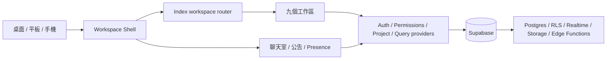

> 集中副本；原始路徑：`README.md`；程式參考基準：`06c686951b17afa920cf325ddfec9114590aeee0`。歷史文件保留當時語意，先以 00_閱讀指南.md 與現行手冊判定適用範圍。

# 工作整合平台

**Station Status Hub** 是提供測試站、硬體工程與管理團隊共同使用的整合工作平台。它把機台維修、工程檔案、A／B 工程比對、BOM 與料號、Data Center、PCB 設計、權限管理、AI 資料查詢和績效考核收進同一套登入、權限、即時同步與響應式介面。

[開啟線上版本](https://lovableteat.github.io/station-status-hub/) · [閱讀完整架構](./docs__architecture.md) · [跨電腦重建與交接](./docs__%E8%B7%A8%E9%9B%BB%E8%85%A6%E9%87%8D%E5%BB%BA%E8%88%87%E4%BA%A4%E6%8E%A5.md)

## 2026-10-20 文件交接入口

要在另一台電腦做功能相似的網站，先讀 [文件包導讀](./00_%E9%96%B1%E8%AE%80%E6%8C%87%E5%8D%97.md)、[功能與使用手冊](./docs__%E7%B3%BB%E7%B5%B1%E5%8A%9F%E8%83%BD%E8%88%87%E4%BD%BF%E7%94%A8%E6%89%8B%E5%86%8A.md)、[資料邏輯](./docs__%E7%B3%BB%E7%B5%B1%E6%9E%B6%E6%A7%8B%E8%88%87%E8%B3%87%E6%96%99%E9%82%8F%E8%BC%AF.md) 和 [UI 設計規則](./docs__UI%E8%A8%AD%E8%A8%88%E9%A2%A8%E6%A0%BC%E8%88%87%E4%BA%92%E5%8B%95%E8%A6%8F%E5%89%87.md)。全部專案 Markdown 的集中副本放在 repo 根目錄 `機台管理系統.md` 資料夾，原始文件保留不移動；同名檔案以原路徑前綴區分。

這是文件包，不含原始碼、正式資料、附件、帳密或 API 金鑰。現有程式核對基準為 `c6629250`；歷史計畫不是全部已實作的承諾，另一台電腦／新後端的部署與全流程仍需獨立驗證。不要把新系統連到原正式資料做試寫。

## 平台內容

平台目前有九個正式工作區，入口會依使用者權限顯示：

| 工作區 | 主要用途 | Workspace ID |
| --- | --- | --- |
| 機台維修紀錄中心 | 儀表板、測試流程、產線監控、問題追蹤與工具管理 | `station-status` |
| 檔案上傳 | 工程檔案、資料夾、文件與試算表預覽 | `file-uploads` |
| 比對系統 | A／B netlist、BOM、線路圖差異、審查追蹤、Power Tree 與 I²C 檢查 | `comparison` |
| 料號申請 | BOM、主料與替代料、供應商明細、申請、匯入匯出與多人同步 | `material-requests` |
| Data Center | 機櫃與設備配置、2D 規劃、3D 數位孿生與場景管理 | `data-center` |
| PCB Designer | PCB 專案、2D 編輯、3D 檢視、STEP 模型、元件庫、禁制區與切板 | `pcb-designer` |
| 後台管理 | 帳號、角色、工作區權限、公告、在線狀態與 API 金鑰 | `user-management` |
| AI 問答 | AI 對話、附件、圖片與文件分析、知識搜尋和引用來源 | `ai-chat` |
| 績效考核系統 | 考核週期、目標進度、主管回饋、評分、團隊檢視與報表 | `performance` |

全站聊天室、私訊、在線狀態、公告中心、手機開啟 QR Code 與帳號資料是跨工作區共用能力。

## 系統架構



`src/pages/Index.tsx` 是全站工作區分派中心。頁面使用 `workspace` 與 `module` query parameter 保存可分享的目前位置，例如：

```text
?workspace=pcb-designer&module=pcb-designer
```

大型工作區以 lazy import 載入，避免首頁同時下載 3D、試算表、Python runtime 與 AI 相關依賴。`src/lib/workspacePermissions.ts` 集中管理七組工作區授權及細部頁面權限；檔案上傳沿用維修中心的資料儲存權限，比對系統沿用資料查詢空間權限。雲端資料安全則由 Supabase RLS、RPC 與 Storage policy 最終把關。

## 專案地圖

```text
station-status-hub/
├─ src/
│  ├─ App.tsx                         # Runtime、Provider、登入閘門與 routes
│  ├─ pages/Index.tsx                 # Workspace shell、URL 狀態與頁面分派
│  ├─ components/layout/              # 頂部導覽、首頁入口與手機工作列
│  ├─ components/maintenance/         # 機台維修工作區
│  ├─ components/comparison/          # AutoCheck 工程比對與本機審查追蹤
│  ├─ components/material-requests/   # 料號與 BOM 工作區
│  ├─ components/data-center/         # Data Center 2D / 3D
│  ├─ components/pcb-designer/        # PCB 畫面、同步與可測試 core
│  ├─ components/admin/               # 後台帳號、公告與權限
│  ├─ components/api-management/      # API 控制台與 AI 資料查詢
│  ├─ components/performance/         # 績效考核工作區
│  ├─ components/collaboration/       # 全站聊天室與私訊
│  ├─ hooks/                          # 資料、權限、Presence 與即時同步 hooks
│  └─ lib/workspacePermissions.ts     # Workspace 與細部頁面權限規則
├─ supabase/
│  ├─ migrations/                     # Schema、RLS、RPC 與 Realtime 變更
│  └─ functions/                      # Edge Functions 與 API proxy
├─ tests/                              # 工作區、RWD、權限與回歸測試
├─ scripts/                            # STEP / GLB 等模型轉換工具
├─ public/models/                      # 經審核後納入部署的 3D 資產
└─ docs/architecture.md                # 完整架構、資料流與開發規則
```

第一次接手請先閱讀 [`docs/architecture.md`](./docs__architecture.md) 的「目錄地圖」、「Workspace 與 module」、「Provider 與資料流」及「新功能開發流程」，再進入對應功能。不要從單一畫面元件推測資料來源或複製另一套權限邏輯。

## 本機啟動

文件整理時本機為 Node.js `24.14.0` 與 npm `11.9.0`；隔離測試 workflow 使用 Node 24，Pages build 仍使用 Node 20。完整測試包含直接執行 TypeScript，不能把「Node 20 可建置」當成「所有 Node 測試可執行」。

```bash
npm ci --legacy-peer-deps
npm run dev
```

Vite 預設入口：

```text
http://localhost:8080/station-status-hub/
```

本機需要 Supabase 時，請複製 [`.env.example`](https://github.com/lovableteat/station-status-hub/blob/06c686951b17afa920cf325ddfec9114590aeee0/.env.example) 為 `.env`，再填入瀏覽器可公開的專案 URL 與 anon key。`.env` 只存在本機，不得加入 Git：

```dotenv
VITE_SUPABASE_URL=your-project-url
VITE_SUPABASE_ANON_KEY=your-anon-key
VITE_SUPABASE_SCHEMA=workspace
VITE_REALTIME_COLLABORATION_V2=true
```

不得將 `.env`、service role key、API provider secret、使用者密碼或未遮罩金鑰提交到 Git；`.env.example` 只保留變數名稱，不放任何值。

## 開發與驗證

```bash
npm run lint
npm run typecheck
npm test
npm run build
npm run test:pcb
```

`tests/` 另外包含 RWD、權限、後台、料號、Data Center、AI、聊天室與績效考核的 Node 回歸測試。修改工作區後不能只看程式碼，至少要實際驗證：

1. 桌面、平板、手機直向與手機橫向沒有水平跑版或操作被遮住。
2. Loading、empty、error、success 與 disabled 狀態都有明確回饋。
3. 上傳、下載、預覽、刪除、儲存、搜尋、返回與重新載入可完成。
4. 需要同步的資料換帳號或換裝置後仍可見，權限不足時不能繞過 UI 存取。
5. PCB 的 2D / 3D 座標、旋轉、Top / Bottom、切板與專案重載保持一致。

## 資料與權限

- 前端由 `UserProvider`、`PermissionsProvider`、`TestProjectProvider`、`UnifiedDataProvider` 與 `UserPresenceProvider` 統一管理登入、權限、專案和協作狀態。
- Supabase 是雲端正式資料來源，涵蓋 Auth、Postgres、RLS、Realtime、Storage 與 Edge Functions；比對系統的上傳檔案由瀏覽器內的 Python Worker 處理，結果與回覆依帳號保存在本機，可透過 ZIP 備份移轉，不上傳原始工程資料。
- Migration 放在 [`supabase/migrations`](https://github.com/lovableteat/station-status-hub/tree/06c686951b17afa920cf325ddfec9114590aeee0/supabase/migrations)，正式環境不可 reset、刪除 schema 或任意重播歷史 migration。
- 正式環境登入、OAuth 過期復原、migration history 不一致時的單檔安全套用與驗證，統一依照 [`docs/supabase-production-migration-runbook.md`](./docs__supabase-production-migration-runbook.md)。
- 應用資料表統一歸檔在 `workspace` schema；Supabase 管理的 `auth`、`storage`、`realtime` schema 不修改。Hosted Supabase 的 API Exposed schemas 必須加入 `workspace`，再套用對應 migration。
- 權限新增或調整時，必須同步檢查入口顯示、workspace access、細部 module 權限、RLS/RPC 與手機導覽。
- API 金鑰只顯示遮罩值；建立、測試、停用與刪除流程不得把明文寫入前端 log 或文件。
- 現有 AI console 會在授權後由瀏覽器使用 provider key，遮罩不等於伺服器端保密；新網站若要求金鑰不抵達前端，需要另行設計與驗證後端代理。
- AutoCheck、部分 Cabinet/L11 設定與未送出草稿有本機瀏覽器儲存邊界，不能假設登入即可跨機恢復；先依各功能備份／匯出，再移轉。
- 檔案庫單檔及批次總量為 1 GiB；其他工作區各有上傳限制。TUS 重試與 metadata 完成確認已修正，但未宣稱正式 1 GiB 實測成功，也未宣稱先前失敗 PDF 已找回。

## 部署方式

`main` 分支推送後，[GitHub Actions](https://github.com/lovableteat/station-status-hub/blob/06c686951b17afa920cf325ddfec9114590aeee0/.github/workflows/main.yml) 會使用 Node.js 20 安裝依賴、建立 production bundle，並部署到 GitHub Pages。`VITE_SUPABASE_URL` 與 `VITE_SUPABASE_ANON_KEY` 由 GitHub Secrets 提供，`VITE_REALTIME_COLLABORATION_V2` 由 GitHub Variables 提供，不存放在儲存庫。這個 workflow 不會套用資料庫 migration；正式資料庫變更需另外依照 [Supabase 正式環境遷移操作手冊](./docs__supabase-production-migration-runbook.md) 執行與驗證。

提交前請確認 `git status`，只加入本次正式程式、測試、migration 與文件。`.preview-current/`、`tmp/`、`supabase/.temp/`、本機轉檔產物和未經審核的大型模型不可一併提交。

## 深入文件

- [文件包導讀](./00_%E9%96%B1%E8%AE%80%E6%8C%87%E5%8D%97.md)：集中資料夾、閱讀順序、收錄範圍與重新產生方式。
- [系統功能與使用手冊](./docs__%E7%B3%BB%E7%B5%B1%E5%8A%9F%E8%83%BD%E8%88%87%E4%BD%BF%E7%94%A8%E6%89%8B%E5%86%8A.md)：九工作區與共用功能的實際使用流程。
- [系統架構與資料邏輯](./docs__%E7%B3%BB%E7%B5%B1%E6%9E%B6%E6%A7%8B%E8%88%87%E8%B3%87%E6%96%99%E9%82%8F%E8%BC%AF.md)：登入、權限、資料實體、同步與儲存邊界。
- [UI 設計風格與互動規則](./docs__UI%E8%A8%AD%E8%A8%88%E9%A2%A8%E6%A0%BC%E8%88%87%E4%BA%92%E5%8B%95%E8%A6%8F%E5%89%87.md)：設計 token、操作層級、篩選契約與桌面／行動驗收。
- [跨電腦重建與交接](./docs__%E8%B7%A8%E9%9B%BB%E8%85%A6%E9%87%8D%E5%BB%BA%E8%88%87%E4%BA%A4%E6%8E%A5.md)：隔離設定、版本、啟動、移轉、部署及已知限制。
- [`docs/architecture.md`](./docs__architecture.md)：完整架構、工作區資料流、RWD、PCB、Supabase、測試與排錯指南。
- [`docs/supabase-production-migration-runbook.md`](./docs__supabase-production-migration-runbook.md)：正式 Supabase 登入、OAuth 過期復原、安全遷移、驗證與登出流程。
- [`docs/codex-handoff-2026-08-10.md`](./docs__codex-handoff-2026-08-10.md)：2026-08-10 歷史交付與當時儲存庫狀態，不是目前新機部署指令。
